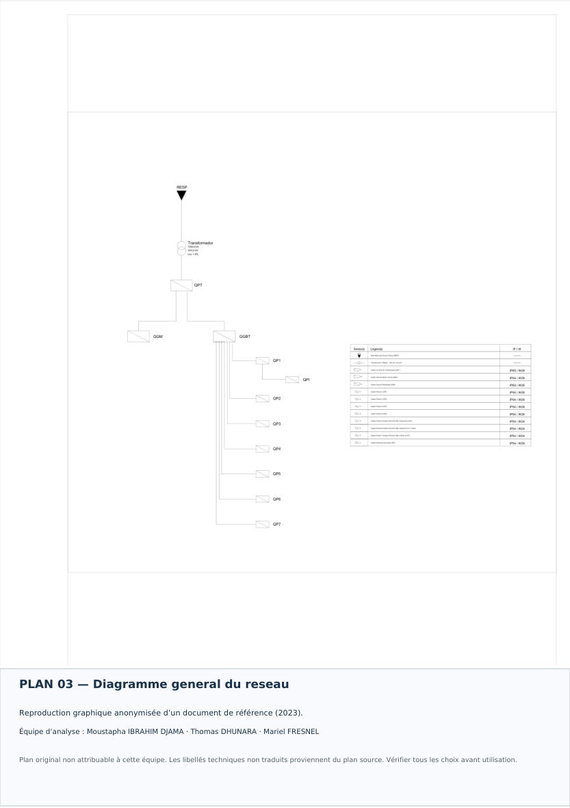
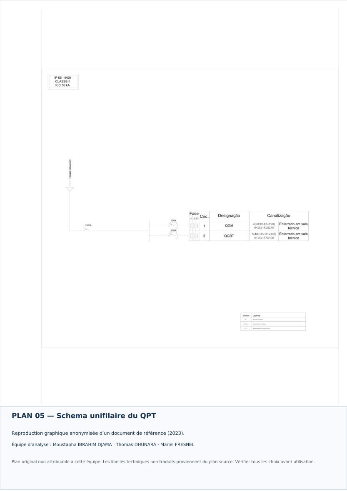
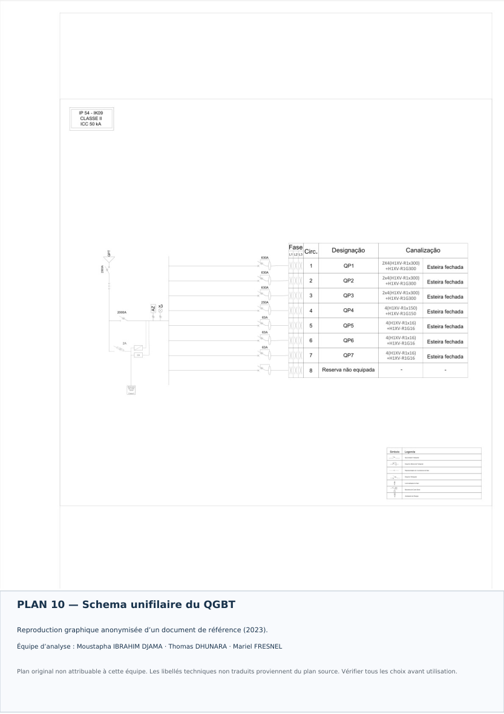
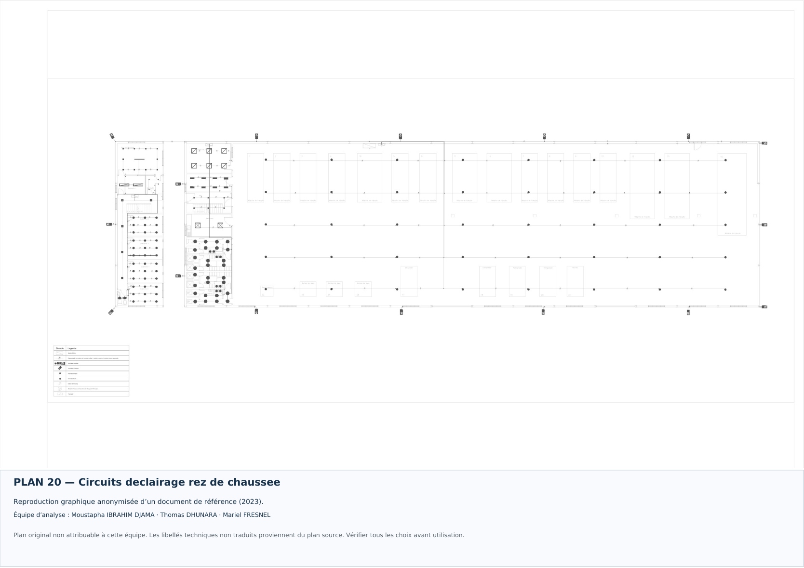

# Étude d'un réseau électrique industriel

**Distribution basse tension · Bilan de puissance · Protections · Schémas unifilaires**

Projet de **relecture, de vérification et de mise en forme pédagogique** à l'ECAM-EPMI, spécialité ISE (Ingénieur en Système Électrique).

**Équipe d'étude :**
- **Moustapha IBRAHIM DJAMA**
- **Thomas DHUNARA**
- **Mariel FRESNEL**

> **Statut : étude documentaire à compléter.** Ce dossier reprend des documents techniques de référence provenant d'un autre projet (2023). Les plans et les chiffres existants ne sont pas des réalisations originales du groupe et n'ont pas été validés pour l'exécution.

## Présentation

Le cas étudié porte sur la distribution électrique d'une usine d'injection de matières plastiques. L'architecture de référence contient une arrivée en **15 kV**, un poste de transformation, un tableau **QPT**, un **QGBT**, un **QGM**, sept tableaux secondaires **QP1 à QP7** et un tableau d'éclairage **QPI**. Le régime de liaison à la terre indiqué est **TT**.

L'objectif de l'étude est de vérifier le bilan de puissance, les courants d'emploi, les câbles, les protections et la cohérence des schémas. Les données reprises des annexes doivent être confrontées aux hypothèses de calcul.

## Aperçu des documents

### Architecture du réseau


### Poste de transformation


### Tableau général basse tension


### Exemple de circuit d'éclairage


*Ces aperçus montrent des documents de référence anonymisés. Ils ne constituent pas des schémas originaux conçus par les trois étudiants.*

## Données à vérifier

| Élément | Donnée du dossier source | Observation |
|---|---:|---|
| Alimentation amont | 15 kV | Vérifier les caractéristiques du réseau |
| Tension BT | 400/230 V | Cohérente avec une distribution triphasée usuelle |
| Régime de neutre | TT | Justifier les protections différentielles |
| QPT–QGBT | 717,871 kVA | À rapprocher du bilan du QGBT |
| QGBT | 589,213 kVA dans une fiche | Différence documentaire à expliquer |
| QGM | 208,421 kVA | Vérifier simultanéité et protections |
| Départ QP4 | 78,858 kVA ; 32,59 A | **Incohérence :** ≈ 113,8 A à 400 V triphasé |

Il ne faut pas considérer ces valeurs comme vérifiées avant recalcul.

## Structure du dossier

```text
Projet_reseau_electrique_industriel/
├── README.md
├── 01_Schemas_et_plans_de_reference/    (28 PDF avec titres français)
├── 02_Calculs_et_fiches/
│   ├── Tableau_de_puissances_et_equilibrage.xlsx
│   ├── Fiche_01_Caracteristiques_reseau_BT.pdf
│   ├── Fiche_02_Installation_moyenne_tension.pdf
│   └── Fiche_03_Distribution_basse_tension.pdf
├── 03_Illustrations/                (6 aperçus sans anciens cartouches)
└── 04_Analyse_en_francais/
    ├── Synthese_technique_et_points_a_verifier.pdf
    └── Sources_et_limites.md
```

## Documents de référence et limites

Les schémas sont des **reproductions pédagogiques anonymisées** : les cartouches portant les anciens noms ont été exclus et remplacés par des titres français et une mention de leur origine. Une partie des inscriptions internes aux schémas reste dans la langue source afin de ne pas altérer les données électriques. Le vocabulaire associé est repris dans la synthèse technique.

Les documents d'origine ayant une fonction administrative, de signature ou d'identification n'ont pas été transformés en attestations au nom du groupe. Le volumineux rapport DIALux en langue source et les fichiers AutoCAD d'origine ne sont pas redistribués dans cette version : leur réutilisation demanderait un contrôle supplémentaire.

## Travaux à effectuer par le groupe

1. Vérifier les puissances et les facteurs de simultanéité dans le fichier Excel.
2. Refaire les calculs des courants à partir des puissances et tensions retenues.
3. Justifier les sections de câbles, les conditions de pose, les chutes de tension et la protection des personnes.
4. Examiner les courants de court-circuit, les pouvoirs de coupure et la sélectivité.
5. Produire une version propre des schémas et une note finale présentant uniquement les contributions effectivement réalisées par le groupe.

**Outils présents dans les documents source :** Excel, AutoCAD et DIALux. Leur utilisation par notre groupe reste à documenter selon les travaux réellement effectués.

## Contact

Moustapha IBRAHIM DJAMA · Thomas DHUNARA · Mariel FRESNEL  
ECAM-EPMI · Spécialité ISE

[Portfolio de Moustapha IBRAHIM DJAMA](https://portfolio-eta-ten-t34s52rvq8.vercel.app/)

---


